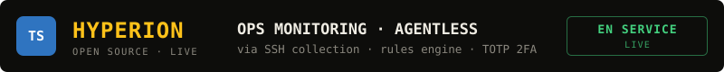
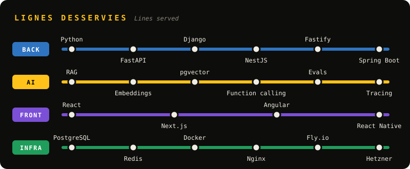
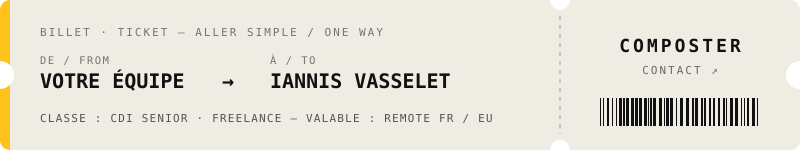

<a href="https://portfolio-v4-jet-rho.vercel.app"></a>


<a href="https://github.com/iannis-walter/Stratos"></a>
<a href="https://askme-ashy.vercel.app"></a>
<a href="https://github.com/iannis-walter/Quote-part"></a>
<a href="https://hyperion-v2-web.vercel.app"></a>
<a href="https://www.aria-asso.com"></a>
<a href="https://fit-ai-self.vercel.app"></a>
<a href="https://github.com/iannis-walter/sillage"></a>
<a href="https://cachotte-site.vercel.app"></a>

<p align="center"><sub>Chaque ligne est cliquable · Every row is clickable</sub></p>



```text
ARRÊTS PRÉCÉDENTS · PREVIOUS STOPS
──────────────────────────────────────────────────────────────────────
NOW       ISOFT ................. Freelance studio · web, e-commerce, AI
2026      WALTER LEARNING ....... Senior full-stack · EdTech SaaS, CRM, LLM
2025      YNOV CAMPUS AIX ....... MSc Computer Science
2022–25   POLICE JUDICIAIRE ..... Full-stack & project lead · 50K+ users
2022      CEA CADARACHE ......... Full-stack internship · reactor deliverables
```

<a href="https://portfolio-v4-jet-rho.vercel.app/#contact"></a>

<p align="center">
  <a href="https://portfolio-v4-jet-rho.vercel.app">Portfolio</a> ·
  <a href="https://portfolio-v4-jet-rho.vercel.app/cv.pdf">CV</a> ·
  <a href="https://www.linkedin.com/in/iannis-vasselet/">LinkedIn</a> ·
  <a href="mailto:iannisvasselet@gmail.com">Email</a>
</p>

<details>
<summary><sub>Information voyageurs · Why does this account look new?</sub></summary>
<br>
My previous GitHub account was permanently suspended, so I started fresh here. The commit history on this account is recent and doesn't reflect my actual years of experience. The projects on this board are real, and several were built before this account existed. Private repos (ARIA, Fit-ai) can be shown on request.
</details>

<p align="center"><sub>Aucun train n'a été retardé pendant la fabrication de ce profil.</sub></p>
